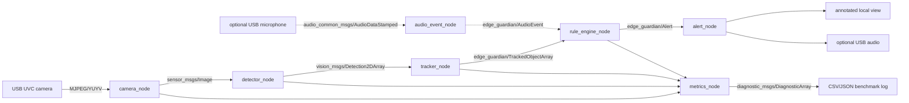
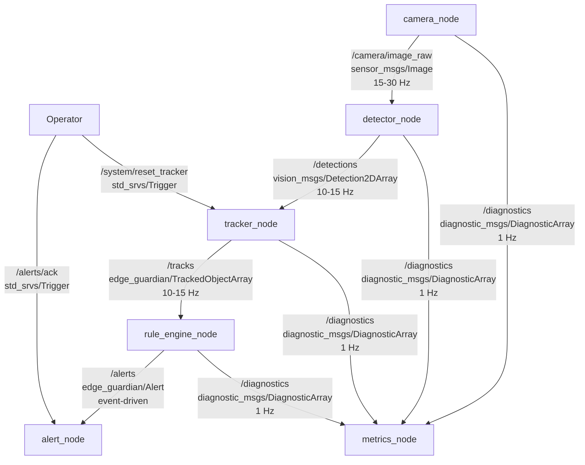

# RDK Edge Guardian — AI and ROS 2 Architecture

## 1. System data flow

The solid path is the required camera-first release. The dotted audio path is optional and cannot block completion.

## 2. ROS 2 node graph and expected rates

Target rates are design values and will be tuned on the board. The detector may intentionally process fewer frames than the camera publishes so that the newest frame is preferred over an old queue.

## 3. Module contracts and failure modes

| Module | Responsibility | Input | Output | Principal failure | Detection and response |
|---|---|---|---|---|---|
| `camera_node` | Open UVC device, timestamp and publish frames | `/dev/video*`, camera parameters | `/camera/image_raw`, diagnostics | Device missing, busy, or disconnected | Publish ERROR, retry with bounded backoff, automatically resume |
| `detector_node` | Resize/convert to NV12 and run YOLOv5 on BPU | Image stream, model and threshold config | `/detections`, latency diagnostic | Model/runtime mismatch or inference exception | Fail launch on invalid model; count errors; publish stale status |
| `tracker_node` | Associate detections and maintain temporary IDs | Detection array | `/tracks` | ID switch during occlusion | Expire old tracks; expose confidence/age; do not infer identity |
| `rule_engine_node` | Evaluate polygon, class, confidence, and dwell-time rules | Tracks and optional audio events | `/alerts`, rule diagnostics | Alert chatter or stale data | Hysteresis, cooldown, maximum input age, explicit state machine |
| `alert_node` | Render preview and issue local notification | Alerts, images, tracks | Display/audio, acknowledgment service | Speaker/display absent | Continue headless and log alert; audio is optional |
| `metrics_node` | Aggregate FPS, latency, drops, heartbeat, resources | Diagnostics from all nodes | `/system/status`, CSV/JSON | Disk full or a node stops reporting | File rotation; mark missing heartbeat; keep core perception running |
| `audio_event_node` (optional) | Detect a small set of acoustic events | Timestamped PCM audio | `/audio/events` | No audio device or high noise | Disable cleanly; camera-only fallback |

## 4. Compute allocation

| Resource | Assigned work | Reason |
|---|---|---|
| RDK X5 BPU | YOLOv5s neural-network inference | Hardware acceleration is the core platform capability and avoids CPU-only inference |
| RDK X5 CPU | UVC capture, image conversion, post-processing, tracking, rules, ROS 2 transport, metrics, optional audio features | These are control-heavy/lightweight workloads suited to CPU execution |
| RDK X5 memory/storage | Latest-frame buffers, model, short metric logs, configuration | Bounded queues prevent old frames and memory growth |
| Windows PC | Development, SSH, optional viewing, documentation, and video editing | Not required for inference or alert decisions |
| Off-board/cloud | None in the default runtime | Preserves privacy and operation without internet |

## 5. Timing and concurrency design

- Capture timestamps are generated once at the camera boundary and preserved downstream.
- Queue depth is kept small (`1` or `2`) for image topics; slow consumers drop old frames instead of increasing latency.
- BPU inference and CPU tracking run in separate ROS 2 nodes/executors, proving two concurrent workloads.
- Each alert records `source_stamp`, `decision_stamp`, class, track ID, zone, rule, and confidence.
- If audio is enabled, both image and audio events use the RDK system clock. The fusion window starts at +/-300 ms and is tuned from recorded timestamps.
- A track or audio event older than the configured maximum age is rejected.

## 6. ROS 2 interfaces

| Name | Type | Key fields / purpose |
|---|---|---|
| `/camera/image_raw` | `sensor_msgs/msg/Image` | Timestamped BGR/RGB image |
| `/detections` | `vision_msgs/msg/Detection2DArray` | Class, score, and bounding box |
| `/tracks` | Custom `TrackedObjectArray` | Track ID, class, score, box, age, zone membership |
| `/alerts` | Custom `Alert` | Severity, rule, track ID, zone, timestamps, message |
| `/system/status` | `diagnostic_msgs/msg/DiagnosticArray` | FPS, average/p95 latency, drops, heartbeat, BPU/runtime state |
| `/alerts/ack` | `std_srvs/srv/Trigger` | Acknowledge current alert |
| `/system/reset_tracker` | `std_srvs/srv/Trigger` | Clear temporal state after a camera move |

Custom messages will live in `edge_guardian_interfaces` so perception and UI nodes remain loosely coupled.

## 7. Deployment and safety behavior

One launch file starts the required nodes with a validated YAML configuration. Startup fails with a clear error when the model or required camera cannot be opened. The alert output never drives a motor in the initial release, so a false positive can produce only a visual/audio notification. The system publishes `STALE` when frames stop and never treats missing data as a safe scene.

