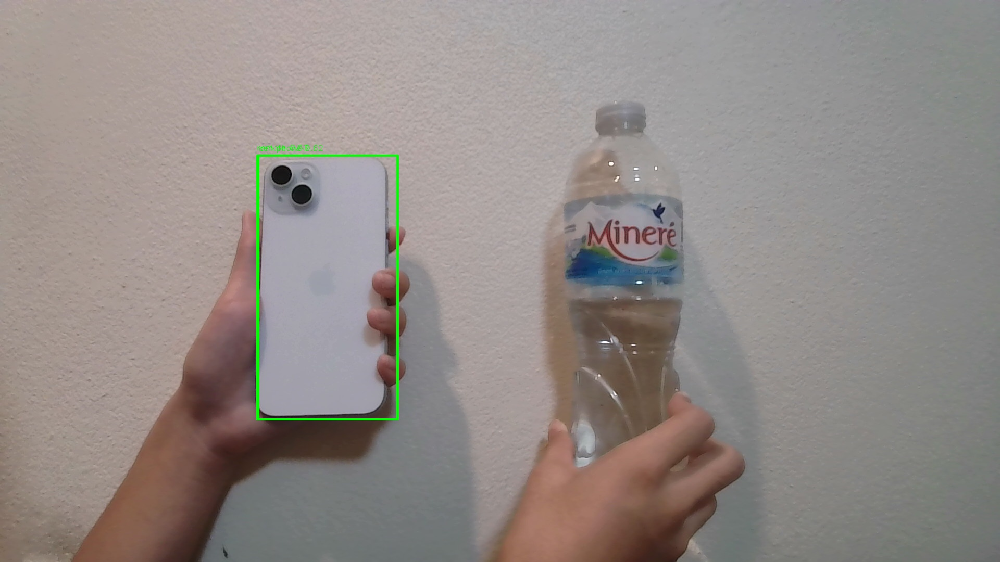

# RDK X5 USB Camera YOLOv5 BPU Demo

Stage 1 (Ignite) submission material for the Robotics Dream Keeper Challenge 2026 Winter. This project brings up an RDK X5, verifies network and SSH access, captures an image from a USB UVC camera, and runs YOLOv5 object detection on the RDK X5 BPU.

## Result

The board successfully detected a mobile phone in a frame captured by the connected USB webcam.



## Hardware

- D-Robotics RDK X5
- 64 GB microSD card (58 GB usable capacity reported by Linux)
- Sunplus Full HD USB webcam (`1bcf:2283`)
- Windows development PC on the same Wi-Fi network

## Tested environment

- RDK OS: `3.2.3`
- Ubuntu: `22.04.5 LTS`
- Kernel: `6.1.83`
- Architecture: `aarch64`
- Python: system Python 3
- BPU Platform: `1.3.6`
- DNN Runtime: `1.24.5` / HBRT `3.15.55.0`
- OpenCV: `4.11.0`

## Repository layout

```text
rdk_stage1/
├── README.md
├── LICENSE
├── requirements.txt
├── src/
│   └── yolo_camera_evidence.py
└── evidence/
    ├── ssh_internet_evidence.png
    ├── system_sd_evidence.png
    ├── camera_evidence_02.jpg
    ├── yolo_camera_result_02.jpg
    └── yolo_camera_result_02.log
```

## 1. Connect to the board

Find the board IP address on its local terminal with `ip -4 -br addr show`, then connect from Windows PowerShell:

```powershell
ssh sunrise@<RDK_IP_ADDRESS>
```

Do not publish passwords, Wi-Fi credentials, private keys, tokens, or device serial numbers.

## 2. Verify the system and camera

```bash
cat /etc/version
uname -a
lsblk -o NAME,SIZE,TYPE,MOUNTPOINTS
lsusb
v4l2-ctl --list-devices
```

Expected camera nodes on this setup:

```text
/dev/video0
/dev/video1
```

## 3. Capture a camera frame

The webcam supports MJPEG at 1920x1080 and 30 FPS. Capture one frame:

```bash
mkdir -p ~/rdk_stage1

v4l2-ctl -d /dev/video0 \
  --set-fmt-video=width=1920,height=1080,pixelformat=MJPG \
  --set-parm=30 \
  --stream-mmap=3 \
  --stream-skip=10 \
  --stream-count=1 \
  --stream-to=~/rdk_stage1/camera_evidence.jpg
```

## 4. Run YOLOv5 on the BPU

The model supplied by this RDK OS image is located at:

```text
/app/pydev_demo/models/yolov5s_672x672_nv12.bin
```

Copy the script to the board and run:

```bash
python3 src/yolo_camera_evidence.py \
  --input ~/rdk_stage1/camera_evidence.jpg \
  --output ~/rdk_stage1/yolo_result.jpg \
  --score-threshold 0.4 2>&1 | tee ~/rdk_stage1/yolo_result.log
```

Successful BPU execution prints lines similar to:

```text
[BPU_PLAT]BPU Platform Version(1.3.6)!
[DNN] Runtime version = 1.24.5_(3.15.55 HBRT)
name: cell phone
```

## Evidence

- [SSH and internet connectivity](evidence/ssh_internet_evidence.png)
- [RDK OS and SD-card layout](evidence/system_sd_evidence.png)
- [USB camera frame](evidence/camera_evidence_02.jpg)
- [YOLOv5 BPU result](evidence/yolo_camera_result_02.jpg)
- [BPU inference log](evidence/yolo_camera_result_02.log)

## Troubleshooting

### SSH times out

- Confirm the PC and RDK X5 are on the same subnet.
- Test the board with `ping <RDK_IP_ADDRESS>`.
- Test SSH port 22 from PowerShell with `Test-NetConnection <RDK_IP_ADDRESS> -Port 22`.
- Pass only one host to SSH: `ssh sunrise@<RDK_IP_ADDRESS>`.

### Camera is not listed

- Connect the webcam to a USB Type-A host port on the RDK X5.
- Check `lsusb`, `ls -l /dev/video*`, and `v4l2-ctl --list-devices`.
- Try `/dev/video1` if `/dev/video0` is not the capture node.

### Camera is busy

Close any live-preview application that already owns `/dev/video0`, then retry the capture.

### No objects are detected

- Use a well-lit scene and a COCO class such as a person, bottle, chair, or mobile phone.
- Keep the object fully visible and avoid placing it too close to the lens.
- Lower `--score-threshold` only when necessary.

### BPU model/runtime warning

The tested RDK OS image reports a model-builder/runtime version warning. Inference still completed on this board, but production deployments should use a model built with the matching OpenExplorer/BPU SDK version.

## Attribution

`src/yolo_camera_evidence.py` is adapted from the Apache-2.0-licensed D-Robotics YOLOv5 sample included in the RDK OS image. The original D-Robotics copyright and license header are retained.

